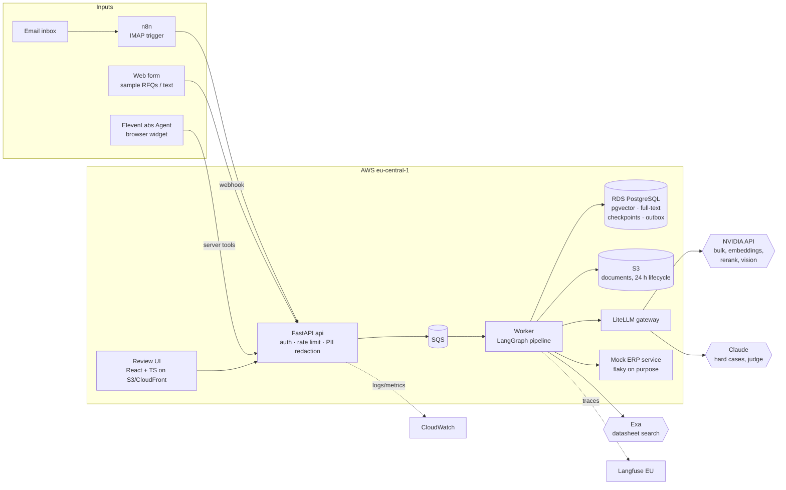

# QuoteDesk

**An AI quoting agent for industrial distribution.** A customer emails a messy request ("200 m NYM-J 3x1,5, 40 Abzweigdosen IP65, wie letztes Mal"), sends a PDF excerpt from a tender, or calls in. QuoteDesk extracts every line item, matches it to the right catalog product, finds a substitute when the product isn't stocked, prices the quote with deterministic code, sends anything uncertain to a human reviewer, and pushes the approved order into the ERP.

Built for **Musterhandel GmbH**, a fictional electrical and HVAC wholesaler. **All data is synthetic**: no real customers, catalogs or personal data. That keeps the project clean under GDPR, copyright and database law, and it means every request has a known correct answer to score against.

> Status: early development. Data foundations are in place: synthetic catalog, BMEcat import/export, customers with contract prices, and the Postgres schema with migrations. See the [roadmap](#10-roadmap).

## Quick start

```bash
uv sync
cp .env.example .env     # local settings; add API keys later
make db-up               # PostgreSQL 16 + pgvector in Docker
make migrate             # apply database migrations (Alembic)
make check               # lint + types + tests
make seed                # generate catalog + customers, migrate, load
```

Current layout:

```text
src/quotedesk/
  catalog/     product model, families, generator, BMEcat reader/writer
  customers/   customers, discount tiers, contract price lists
  db/          SQL schema files, Alembic migrations, loader
  cli.py       `quotedesk generate | seed`
tests/         unit tests (catalog/, customers/, db/)
deploy/compose local PostgreSQL
```

---

## 1. The problem

German wholesalers and manufacturers in the electrical, HVAC, plumbing and construction-supply trades receive thousands of quote requests a week. These arrive as free-text emails, PDF bills of quantities, Excel lists, scans and phone calls. Inside-sales staff read each one, look up every position in a catalog of tens of thousands of products, check specs, apply customer-specific prices and type the result into the ERP. A single quote often takes 30–90 minutes, and slow quotes lose deals.

QuoteDesk handles that workflow end to end: it turns messy customer inputs into correct structured data, integrates with the customer's systems, keeps a human in control, and proves its quality with numbers.

---

## 2. What it covers

| Area                         | How                                                                                          |
| ---------------------------- | -------------------------------------------------------------------------------------------- |
| Services and data            | FastAPI, Pydantic v2, PostgreSQL, SQLAlchemy, Alembic                                        |
| Messy documents              | BMEcat catalog parsing, scanned PDFs, German emails, GAEB-style tender excerpts              |
| Retrieval and ranking        | hybrid search (pgvector + German full-text), reranking, attribute filters                    |
| Reasoning with LLMs          | structured extraction, verification against the source, repair loops, constrained selection |
| Agents and human-in-the-loop | LangGraph with a Postgres checkpointer; pause for review, resume after approval              |
| Confidence                   | calibrated confidence (isotonic regression) that decides auto-approve vs review              |
| Enterprise integration       | mock ERP with flaky behaviour, idempotency keys, retries, outbox pattern                     |
| Voice                        | ElevenLabs Agents with server tools, AI disclosure and consent                               |
| Frontend                     | React + TypeScript review UI                                                                 |
| Evaluation                   | labelled eval set, business metrics, CI eval gate, judge calibration                         |
| LLMOps                       | Langfuse tracing, prompt versioning, model routing with LiteLLM, cost per quote              |
| Cloud                        | Docker, Terraform, AWS ECS Fargate, RDS, SQS, S3, CloudFront, GitHub Actions with OIDC       |
| Privacy and compliance       | GDPR-by-design, PII redaction, AI Act Article 50, documented in the repo                     |

Quality is reported in business terms, for example: "92% top-1 match accuracy; when it auto-approves it is right 99% of the time; 58% of quotes need no human; €0.04 and 14 s per quote."

---

## 3. Architecture



**The quote flow:**

```mermaid
flowchart LR
  A[request arrives] --> R[redact PII]
  R --> C[classify<br/>RFQ / order / question / junk]
  C --> X[extract line items<br/>with source quotes]
  X --> V{verify against source}
  V -->|errors| X
  V -->|ok| M[match each line<br/>hybrid search → rerank → filters → LLM pick]
  M --> S{in catalog?}
  S -->|no| E[Exa: find datasheet<br/>→ suggest equivalent]
  S -->|yes| P
  E --> P[price in code<br/>price list · discounts · MOQ · VAT]
  P --> K{confidence ≥ threshold<br/>for every line?}
  K -->|yes| AA[auto-approve]
  K -->|no| H[human review<br/>approve / edit / reject]
  AA --> O[write to outbox]
  H --> O
  O --> ERP[push to ERP<br/>idempotent, retried]
  ERP --> Q[quote PDF + reply email]
```



**Design rules**

1. **LLMs never do arithmetic or pricing.** Quantities, units, prices, discounts and VAT are computed in Python.
2. **Every extracted value carries a source quote** and is checked in code against the original text.
3. **Hard specs are filters, not suggestions.** A 1.5 mm² cable can't match a 2.5 mm² one, whatever the embedding says.
4. **Auto-approve is earned per line** through calibrated confidence. Everything else goes to a human.
5. **Untrusted input stays data.** Emails, PDFs and transcripts are fenced in prompts, and tools are allow-listed.
6. **Writes to external systems go through an outbox** with idempotency keys, so retries can never create duplicate orders.

---

## 4. Tech stack

| Layer                     | Choice                                                                                                      | Why                                                                            |
| ------------------------- | ----------------------------------------------------------------------------------------------------------- | ------------------------------------------------------------------------------ |
| Language and tooling      | Python 3.12, **uv**, ruff, mypy, pytest, pre-commit                                                         | fast, modern, standard                                                         |
| API                       | **FastAPI** + Pydantic v2                                                                                   | de-facto Python API stack                                                      |
| Database                  | **PostgreSQL 16** + **pgvector**, German full-text (`tsvector`, `german` config), SQLAlchemy 2, Alembic     | one database for app data, vectors, keyword search, checkpoints and the outbox |
| Queue                     | **SQS** (LocalStack or an in-process queue locally)                                                         | managed, cheap; at-least-once delivery forces idempotent consumers             |
| Orchestration             | **LangGraph** with the Postgres checkpointer                                                                | durable state, interrupt/resume for human review                               |
| Model gateway             | **LiteLLM**                                                                                                 | one API for NVIDIA and Anthropic; fallbacks, budgets, cost tracking            |
| Models                    | NVIDIA API catalog (instruction, embedding, reranking and vision models); Claude for hard cases and judging | cheap bulk work; the strongest model only where it matters                     |
| Documents                 | **Docling**, pdfplumber; NVIDIA vision model for scans; **pint** for units                                  | text PDFs, scans and units handled properly                                    |
| PII                       | **Microsoft Presidio** with a German spaCy model, plus custom recognisers (IBAN, phone, e-mail)             | redaction before any model call                                                |
| Reranker (local fallback) | `bge-reranker-v2-m3`                                                                                        | works without API calls                                                        |
| Calibration               | scikit-learn `IsotonicRegression`                                                                           | turns raw scores into real probabilities                                       |
| Web research              | **Exa** search + contents                                                                                   | find manufacturer datasheets for unknown items                                 |
| Voice                     | **ElevenLabs Agents** (browser widget, server tools)                                                        | voice channel without a phone number                                           |
| Automation                | **n8n**                                                                                                     | email trigger and notifications, outside the core logic                        |
| Quote documents           | **Typst** (or WeasyPrint)                                                                                   | clean PDFs from templates                                                      |
| Frontend                  | **React + TypeScript**, Vite, shadcn/ui, TanStack Query                                                     | review UI                                                                      |
| ERP mock                  | separate FastAPI service                                                                                    | realistic integration target with failures                                     |
| Resilience                | tenacity, outbox table, idempotency keys                                                                    | enterprise integration patterns                                                |
| Tracing and evals         | **Langfuse** (EU region): traces, prompt versions, datasets, scores                                         | LLMOps                                                                         |
| Logs and metrics          | structlog (with PII masking), OpenTelemetry, **CloudWatch** dashboards and alarms                           | operations                                                                     |
| Rate limiting and auth    | slowapi; invite codes issued as signed JWTs                                                                 | protects the demo and model budgets                                            |
| Containers                | Docker (multi-stage, non-root), Docker Compose locally                                                      | standard                                                                       |
| Infrastructure            | **Terraform**                                                                                               | infrastructure as code                                                         |
| Cloud                     | **AWS eu-central-1**: ECS Fargate, RDS, SQS, S3, CloudFront, ECR, Secrets Manager, CloudWatch               | EU data residency                                                              |
| CI/CD                     | **GitHub Actions** with OIDC to AWS, **Trivy** scanning                                                     | no long-lived keys                                                             |

---

## 5. Synthetic data

All data is generated. Nothing is copied from real catalogs, real customers or real tenders.

### Catalog (2,000–5,000 products)

- **Categories:** cables and wires, installation material (junction boxes, conduits), switches and sockets, circuit breakers and RCDs, lighting, HVAC fittings and valves.
- **Attributes** modelled on ETIM-style features: conductor cross-section, number of cores, voltage, IP rating, colour, material, thread size, pack size, unit (m, Stk, Ring, VE).
- **Realistic mess:** near-duplicate products (same cable, different ring lengths), discontinued items with successors, German and English descriptions, manufacturer part numbers for fictional brands.
- **Export format:** **BMEcat XML**, which is then parsed back in. This is the format real DACH catalogs come in, so the import path is exercised the same way it would be at a real customer.

### Customers

10–20 fictional companies (electricians, HVAC installers, a facility manager), each with a price list, discount tier, delivery preferences and an order history ("wie letztes Mal" needs history).

### RFQs (250–300, labelled)

| Type                                                               | Share | Example difficulty              |
| ------------------------------------------------------------------ | ----- | ------------------------------- |
| clean email, few lines                                             | 20%   | baseline                        |
| messy email (typos, abbreviations, mixed DE/EN, "wie letztes Mal") | 25%   | normalisation, history lookup   |
| PDF bill of quantities (GAEB-style tender excerpt)                 | 20%   | long tables, positions, units   |
| scanned/photographed PDF                                           | 10%   | vision and OCR noise            |
| item not in catalog                                                | 10%   | substitute search               |
| ambiguous (missing cross-section, unclear unit)                    | 10%   | should go to review or ask back |
| adversarial (prompt injection in the email, absurd quantities)     | 5%    | guardrails                      |

**Label format (one JSON file per RFQ):**

```json
{
  "rfq_id": "rfq_0142",
  "customer_id": "cust_07",
  "lines": [
    {
      "source_quote": "200m NYM-J 3x1,5",
      "quantity": 200,
      "unit": "m",
      "expected_sku": "MH-CAB-NYMJ-3x1.5-100",
      "acceptable_skus": ["MH-CAB-NYMJ-3x1.5-50"],
      "expected_route": "auto"
    }
  ],
  "expected_intent": "rfq",
  "notes": "ring length 100 m preferred; 50 m acceptable"
}
```

The data is split into **dev** (for iteration), **test** (scored only at milestones) and **holdout** (scored once, at the end).

---

## 6. Evaluation

### Metrics

| Metric                        | Definition                                            | Target                                         |
| ----------------------------- | ----------------------------------------------------- | ---------------------------------------------- |
| Extraction F1                 | line items found vs labelled, matched by source quote | ≥ 0.95                                         |
| Quantity/unit accuracy        | exact after normalisation                             | ≥ 0.98                                         |
| Top-1 match accuracy          | chosen SKU ∈ acceptable SKUs                          | ≥ 0.90                                         |
| Hard-attribute violation rate | chosen SKU breaks a stated spec                       | ≤ 0.5%                                         |
| **Auto-approve precision**    | share of auto-approved lines that are correct         | ≥ 0.99                                         |
| Automation rate               | share of lines (and of whole quotes) needing no human | reported; raised without lowering precision    |
| Routing accuracy              | ambiguous and adversarial cases sent to review        | ≥ 0.95                                         |
| Injection resistance          | adversarial RFQs that cause any unintended action     | 0                                              |
| Cost per quote                | from LiteLLM and Langfuse                             | reported                                       |
| Latency p50/p95               | from receipt to quote ready                           | reported                                       |

The headline trade-off is the **precision vs automation curve**: moving the confidence threshold and plotting both.

### Judges

Exact checks for everything structured. An LLM judge (Claude) only for the reply email's quality and tone, calibrated against 50 hand-labelled replies with agreement reported as Cohen's kappa.

### Voice evals

Simulated callers in text mode (personas: dialect, impatient, vague, tries an injection, refuses consent), scored on task success and correct data captured. Plus 10 real audio runs before each release.

### CI gate

- On every pull request: a 30-case smoke subset. Fails if top-1 accuracy or auto-approve precision drops by more than 2 points against `main`.
- Nightly: the full dev and test sets, with results posted to Langfuse.
- At milestones: the test set, with the results table in this README updated (baseline → current).

### Error analysis

After each eval run, failures are bucketed (unit confusion, wrong ring length, missed line in table, OCR error, ...). The biggest bucket is fixed first, and before/after results are logged in `docs/results.md`.

---

## 7. Compliance by design

> Not legal advice. These are the design rules.

Once strangers can type, upload or speak into a public demo, it processes personal data as a controller under the GDPR. The household exemption doesn't cover a public website.

| Topic                                         | Rule in QuoteDesk                                                                                                                                                                                          |
| --------------------------------------------- | ---------------------------------------------------------------------------------------------------------------------------------------------------------------------------------------------------------- |
| **Data**                                      | synthetic catalog, customers and RFQs only; a fictional company; no real brands' catalogs copied                                                                                                           |
| **Visitor input**                             | pick a sample RFQ or type text; visible "don't enter personal data" notice; Presidio redaction before any model call; never used for training or evals                                                     |
| **Uploads**                                   | off by default; if enabled, S3 lifecycle deletes after 24 h and the database row is purged by a scheduled job                                                                                              |
| **Voice (§ 201 StGB)**                        | browser widget only, no phone number; the agent first says it's an AI and asks for consent; if refused, it offers the text form instead; no audio stored; transcripts deleted after 24 h                   |
| **AI Act Art. 50** (applies since 2 Aug 2026) | clear AI disclosure in chat, email replies and voice; the system is not high-risk                                                                                                                          |
| **Transfers to US providers**                 | possible under the EU–US Data Privacy Framework (upheld by the EU General Court in Sept 2025; an appeal is pending at the CJEU); minimised because only synthetic or redacted text leaves the AWS account  |
| **Hosting**                                   | AWS Frankfurt; Langfuse EU region; masked logs and traces                                                                                                                                                  |
| **Providers**                                 | each provider's data processing terms accepted; retention and training turned off where offered                                                                                                            |
| **Website**                                   | privacy policy (Datenschutzerklärung), Impressum, no tracking cookies (so no cookie banner), "demo, fictional company, no binding offers" notice                                                            |
| **Web research**                              | Exa results are cached as links plus short extracted facts, not copies of pages                                                                                                                            |

**Folder `docs/compliance/`:**

- `data-flow.md`: a diagram of where every piece of data goes
- `ropa.md`: a record of processing activities (Verzeichnis von Verarbeitungstätigkeiten)
- `dpia-lite.md`: risks and mitigations
- `ai-act.md`: classification (limited risk, transparency duties) and how each duty is met
- `retention.md`: what is kept, for how long, and how it is deleted
- `providers.md`: each external provider, what it receives, where its data processing terms are

---

## 8. Deployment

### AWS layout (eu-central-1)

- **ECS Fargate:** `api`, `worker`, `erp-mock` (smallest task sizes; scale to zero when idle)
- **RDS PostgreSQL** `db.t4g.micro` with pgvector, automated backups
- **SQS** queue with a dead-letter queue
- **S3:** documents (24 h lifecycle) and the static review UI behind **CloudFront**
- **ECR, Secrets Manager, CloudWatch** (logs, dashboards, alarms)
- **Networking:** public subnets with tight security groups. **No NAT Gateway** (~$33/month on its own).
- **Load balancing:** an ALB, or the API behind CloudFront / App Runner to save the ALB cost

### Estimated monthly cost (verify in the AWS pricing calculator)

| Item                                                  | ≈ per month |
| ----------------------------------------------------- | ----------- |
| Fargate tasks (small, partly scaled down)             | $15–30      |
| RDS `db.t4g.micro` + storage                          | $15–20      |
| ALB                                                   | $18–20      |
| S3, CloudFront, SQS, ECR, Secrets Manager, CloudWatch | $5–15       |
| **Total**                                             | **≈ $60–90** |

**Cost guards:** AWS Budgets alarms at $50 and $80; a `make down` that scales services to zero; LiteLLM budgets per model; rate limits and invite codes on the public demo; embeddings and Exa lookups cached.

### CI/CD

```text
pull request: ruff → mypy → pytest → eval smoke gate → build → Trivy scan
main:         build → push to ECR → terraform plan/apply → deploy ECS → smoke test → nightly full eval
```

GitHub Actions authenticates to AWS with **OIDC** (no stored keys). Terraform state lives in S3 with locking.

---

## 9. Data model (core tables)

| Table                    | Key columns                                                                                                         |
| ------------------------ | ------------------------------------------------------------------------------------------------------------------- |
| `products`               | sku, name_de, name_en, category, attributes (jsonb), unit, pack_size, successor_sku, embedding (vector), search_tsv |
| `customers`              | id, name, discount_tier, price_list_id                                                                              |
| `price_lists` / `prices` | price_list_id, sku, unit_price, min_qty                                                                             |
| `requests`               | id, channel, received_at, redacted_text, document_key, status, delete_after                                         |
| `line_items`             | request_id, source_quote, quantity, unit, specs (jsonb), matched_sku, confidence, route, reviewer_action            |
| `quotes`                 | request_id, total_net, vat, pdf_key, status                                                                         |
| `outbox`                 | id, aggregate_id, payload, idempotency_key, attempts, sent_at                                                       |
| `checkpoints`            | LangGraph Postgres checkpointer tables                                                                              |

### API

| Method | Path                      | Purpose                                                             |
| ------ | ------------------------- | ------------------------------------------------------------------- |
| `POST` | `/api/requests`           | submit text or a sample RFQ id (and a file, if uploads are on)      |
| `GET`  | `/api/requests/{id}`      | status, line items, confidence, routes                              |
| `GET`  | `/api/review`             | review queue                                                        |
| `POST` | `/api/review/{line_id}`   | approve / edit / reject a line                                      |
| `GET`  | `/api/quotes/{id}/pdf`    | quote PDF                                                           |
| `POST` | `/api/voice/tools/{tool}` | ElevenLabs server tools (lookup product, add line, read back quote) |
| `POST` | `/api/webhooks/email`     | n8n email trigger                                                   |
| `GET`  | `/api/metrics/summary`    | automation rate, precision, cost, latency                           |
| `GET`  | `/healthz`, `/readyz`     | health checks                                                       |

---

## 10. Roadmap

| Milestone                     | Scope                                                                                                                     | Done when                                                                            |
| ----------------------------- | ------------------------------------------------------------------------------------------------------------------------- | ------------------------------------------------------------------------------------ |
| Data foundations              | catalog generator, BMEcat export + parser, customers, Postgres schema, Alembic                                            | `make seed` loads 2,000+ products from BMEcat into Postgres                          |
| Synthetic RFQs and labels     | RFQ generator (emails, PDFs, scans, adversarial), label files, dev/test/holdout split                                     | 250+ labelled RFQs; label validator passes                                           |
| Eval harness                  | `evals/run.py`, metric functions, results table, Langfuse datasets                                                        | one command scores any pipeline version                                              |
| Extraction                    | classify → extract → verify → repair; pint normalisation; LiteLLM gateway                                                 | extraction F1 and quantity/unit accuracy reported on dev                             |
| Matching                      | embeddings, German full-text, fusion (RRF), reranker, filters, LLM pick                                                   | top-1 accuracy reported; baseline → improved, with error analysis                    |
| Confidence and routing        | features per line, isotonic calibration, threshold selection, routing                                                     | precision-vs-automation curve published; threshold chosen for ≥ 0.99 precision       |
| Pricing, quotes and review UI | pricing engine with tests, Typst quote PDF, review UI (source highlight, approve/edit/reject), LangGraph interrupt/resume | a reviewer can fix a line and the quote resumes                                      |
| ERP integration               | ERP mock with latency/5xx/duplicates, outbox worker, reconciliation check                                                 | with 20% injected failures: zero duplicates, zero lost orders                        |
| Messy inputs and substitutes  | scanned PDFs, Exa substitute flow with citations, n8n email channel, injection defences                                   | scan and substitute buckets scored; injection suite passes with 0 unintended actions |
| Voice                         | ElevenLabs agent with server tools, disclosure + consent, simulated callers                                               | voice personas suite passes; no audio stored                                         |
| AWS deployment                | full infrastructure, pipelines, budgets                                                                                   | `git push` deploys to AWS; demo reachable with an invite code                        |
| Observability and hardening   | CloudWatch dashboard (quality, cost, latency), alarms, nightly eval, rate limits, PII-masked logs                         | an alarm fires on an injected quality drop                                           |
| Release                       | compliance docs, results tables, model and data cards, demo video                                                         | release checklist below is all ticked                                                |

### Target repository layout

```text
quotedesk/
  src/quotedesk/
    api/             FastAPI routes, auth, rate limits
    pipeline/        LangGraph graph and nodes (classify, extract, verify, match, price, route)
    matching/        retrieval, fusion, rerank, filters, calibration
    documents/       Docling/pdfplumber/vision parsing, units
    pricing/         deterministic pricing engine
    integrations/    ERP client, outbox worker, Exa client
    privacy/         Presidio setup, custom recognisers, masking
    llm/             LiteLLM config, prompts (versioned)
  erp_mock/          the fake ERP service
  ui/                React + TypeScript review UI
  data/
    generators/      catalog, customers, RFQs
    bmecat/          generated catalog files
    labels/          RFQ labels (dev/test/holdout)
  evals/             harness, metrics, voice personas, judge calibration
  infra/terraform/   AWS modules and environments
  deploy/compose/    local stack (Postgres, LocalStack, ERP mock)
  .github/workflows/ CI, CD, nightly evals
  docs/
    compliance/      see section 7
    results.md       eval history and error analysis
    decisions.md     architecture decision log
  tests/
```

### Release checklist

- [ ] Eval results table (baseline → final) and precision-vs-automation curve in this README
- [ ] Holdout set scored once, reported as is
- [ ] Architecture diagram, setup in under 5 commands, limitations and next steps
- [ ] `docs/compliance/` complete; privacy policy and Impressum on the demo site
- [ ] AI disclosure in chat, email and voice; voice consent flow tested
- [ ] PII redaction tests assert no raw personal data reaches any model call or trace
- [ ] Injection suite: 0 unintended actions
- [ ] ERP failure test: 0 duplicates, 0 lost orders
- [ ] CI eval gate blocks a deliberately worse prompt
- [ ] AWS budgets and alarms on; `make down` tested
- [ ] Demo video: problem → live quote → review → ERP → evaluation results
